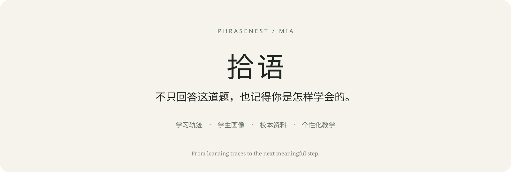
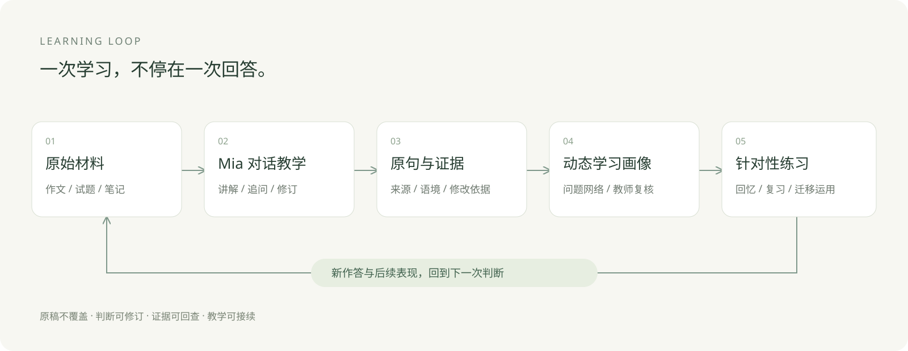
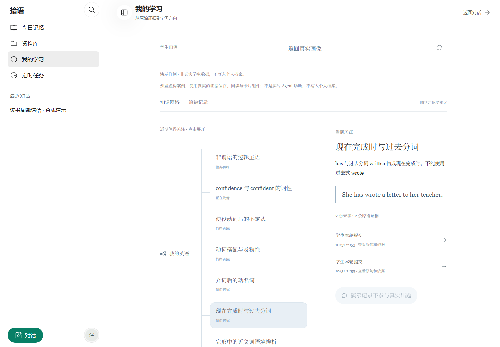
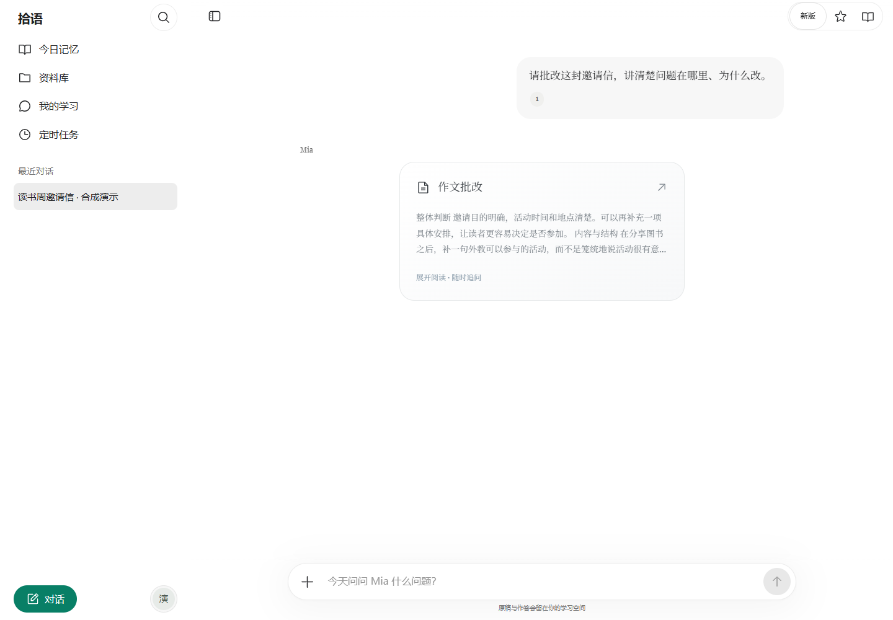
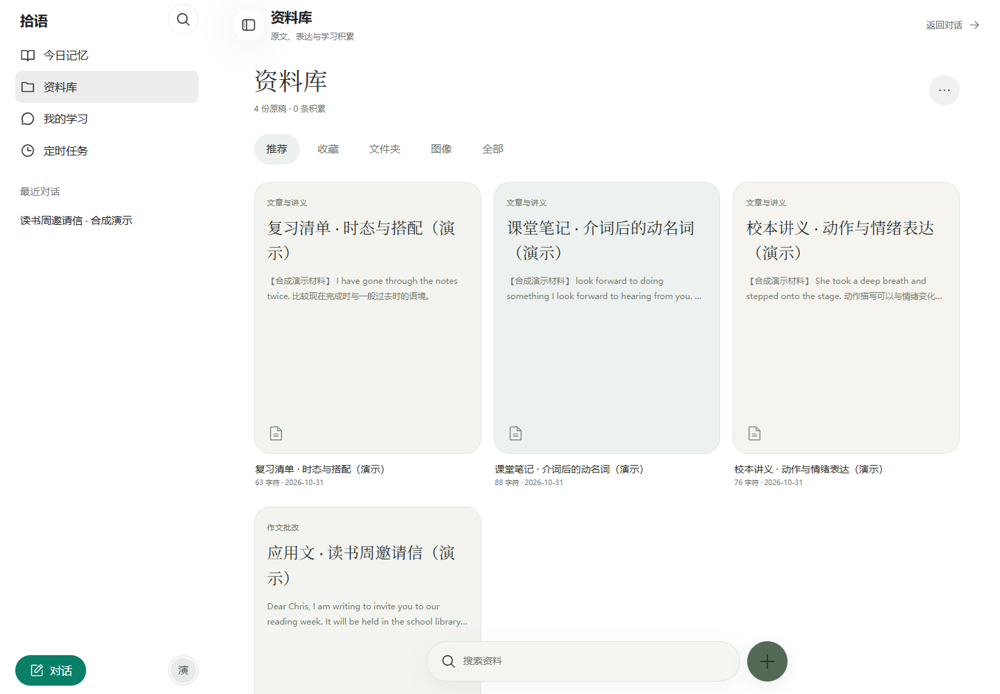

<p align="center"></p>

# 拾语 PhraseNest

### 不只回答这道题，也记得你是怎样学会的。

拾语是一款面向高中英语的 AI 学伴。Mia 从学生的作文、试题、笔记和提问出发，连接**有依据的讲解、可追溯的学习画像、个人语料积累与后续练习**。

我们想解决的不是“再做一个聊天框”，而是：一次批改结束后，学生的问题能否被记住、解释清楚，并在下一次学习中真正用起来？

**Learning traces → learner profile → personalized teaching → practice → new evidence.**

[产品介绍](https://phrasenest-story-zhibi-1019-d4gydbbpp4c7f21dd.webapps.tcloudbase.com/) · [学习平台](https://zhibi-preview-331530-12-1510316597.sh.run.tcloudbase.com/) · [技术架构](docs/architecture.md) · [迭代历程](docs/evolution.md) · [已知问题](docs/known-issues.md)

> 持续迭代中的教学试点。本仓库现已公开真实应用源码，包括前后端、Agent、Skill、证据与画像、资料解析检索和持久化适配。真实学生档案、密钥、数据库快照与个人对话摘录不公开；界面截图均使用合成演示数据。[本地运行与源码说明 →](docs/getting-started.md)

## 源码与本地运行

```bash
git clone https://github.com/Else1337/PhraseNest.git
cd PhraseNest
npm ci
cp .env.example .env.local
npm run dev
```

需要 Node.js 22.13 或更新版本，默认地址 `http://127.0.0.1:3002`。Windows PowerShell 可用 `Copy-Item .env.example .env.local`。填写自己的模型密钥后使用 AI 功能；本地空库不会包含线上账号或资料。生产存储、后台任务和可选服务需另行配置，详见[运行说明](docs/getting-started.md)。

- [`src/`](src/)：页面、接口、Agent、学习证据与资料库业务实现。
- [`skills/`](skills/)：英语精讲与作文批改 Skill，以及按需参考文件。
- [`cloudbase/migrations/`](cloudbase/migrations/)：共享 PostgreSQL 结构与网关迁移；不含数据。
- [`cloudfunctions/`](cloudfunctions/) / [`deploy/node/`](deploy/node/)：定时唤醒函数与容器配置。
- [`tests/`](tests/)：开发中的本地测试；不是本次全部通过的声明。

这是当前代码的独立公开快照，不包含旧私有仓库历史。尚未指定源码开源许可证，请勿将“可以查看源码”理解为任意再分发授权。

## 01 · 让学习，形成闭环

一篇作文里反复出现的问题，不应该在聊天结束后就消失。

拾语保留原始作答、批改依据和后续修订，把零散学习活动串成可回看的学习轨迹。再次遇到相近问题时，Mia 可以沿着证据回查，而不是只依靠一段笼统的“学生总结”。



- **发现**：从真实作答和日常提问中留下问题或关注点。
- **理解**：关联原句、语境、原因和修改参考。
- **练习**：结合相关旧错与个人语料组织后续教学。
- **复核**：用新作答和教师反馈更新判断，旧原稿不被覆盖。

## 02 · 学生画像，不是给学生贴标签

“现在完成时与过去分词”“介词后的动名词”——页面展示具体的语言问题，而不是难以解释的综合分数。

每一个重点都可以展开查看：**从哪份材料发现、当时怎么写、为什么需要练习、后来有没有进步**。对话中的变化卡片，让追踪成为学生看得见的过程。



*演示界面，非真实学生数据。画像是教学参考，不是对学生能力的最终裁决。*

## 03 · 懂你的学伴 Mia

Mia 不只有聊天历史，还能结合稳定学习偏好、近期问题、相关批改证据与当前原稿回答。

- 同一篇作文可以连续追问、修改和回读；完整批改与单句解释使用不同教学范围。
- 作文批改可进入纸张式阅读界面，保留继续询问的入口。
- 资料管理、长期偏好和每日任务有实际工具接口，不只用文字承诺“已经记住”。
- 界面以阅读为先：克制的颜色、清楚的段落、明暗模式与移动端触摸操作。



*预置教学示例展示真实界面，不代表截图时调用了模型，也不作为模型质量评分。*

## 04 · 校本资料，进入真正的教学过程

讲义、试卷和学生笔记不应只是附件列表。资料要先被解析、索引，才可能在需要时被准确找到。

- **解析**：PDF 使用 unpdf，DOCX 使用 Mammoth，图片与扫描页结合 OCR；原件与提取文本分开保存。
- **检索**：关键词、语义与混合检索；Agent 自主选择查询和需要核对的材料。
- **引用**：返回来源、版本和行号，支持从命中段落继续回读原文。
- **对接**：教师可组织班级、导入账号、查看并复核学生证据；更完整的教师批量资料分发仍在完善。



*支持格式不等于任意文件都能无损解析；复杂版式、公式及扫描质量仍需核对原件。*

## 05 · 为高中英语准备的 Skill 库

不是把所有规则塞进一条巨大提示词，而是按任务提供需要的方法。

**英语精讲 Skill**覆盖阅读、完形、七选五、语法、听力与写作相关教学；**作文批改 Skill**针对应用文和读后续写，支持完整批改、内容分析、语法校对、估分、修订与局部追问。

Skill 通过 Mastra 原生接口加载，参考文件按需读取。量规、例句和题型方法与当前原稿一起工作，而不是代替原题和真实依据。

## 技术栈

- **应用与交互**：Next.js 16 · React 19 · TypeScript · Motion · Streamdown。
- **Agent 与上下文**：Mastra Core / Memory / Skills / Workflows · Vercel AI SDK · DeepSeek 文本模型接口。
- **解析与检索**：Mammoth · unpdf · OCR · DashScope Embedding · 关键词 / 语义混合检索。
- **数据与部署**：CloudBase 共享 PostgreSQL HTTP 网关 · 私有原件存储 · 自建持久化适配器 · Docker / Node.js · 腾讯云云托管与私有定时函数。
- **验证方式**：Node 定向测试、类型检查、生产构建、浏览器回放，以及单独授权的真实模型实验。

Mastra 负责 Agent、原生记忆与 Skill 的运行机制；学生证据、画像修订、资料版本、业务租约和持久化适配由项目实现。**“用了框架”不等于框架已经提供完整教育业务。**

## 从写作工具，到持续学习系统

十月重建后，项目逐步从“提交作文—获得批改”扩展为“材料—对话—证据—画像—练习”的连续过程。

- **10 月中旬**：对话成为主入口，整合作文、题目、笔记和今日记忆。
- **10 月下旬**：补充资料检索、后台解析、持久化与定时任务，修正发版覆盖线上数据的旧做法。
- **随后**：学习画像、对话变化卡片、纸张阅读和多轮追问逐步接入。
- **10 月 29 日**：教师 CSV 批量账号、一次性激活、统一证据视图、前端性能与 Mia 引导。
- **10 月 30 日 · 047**：精简教学提示词和 Skill，提供新旧版切换，便于直接比较。

这是工程演进记录，不将本地尚未提交的开发记录伪造成公开 Git 提交历史。[查看迭代与复盘 →](docs/evolution.md)

## 我们仍在解决什么

**可靠性优先于展示数字。** 当前重点包括：

1. 特定多步作文批改仍可能中断，需要定位最终响应与流处理链路。
2. 提示词缩短不自动等于费用下降；工具 schema、重复回读、缓存和后台记忆调用需要独立计量。
3. 复杂文档解析、多账号调度、教师完整教学闭环和移动端性能仍需继续验证。
4. 主动回忆与间隔复习是设计依据；目前不宣称经过教学对照证明“显著提分”。

不把演示数据当真实学生，不把模拟测试当真实模型验收，不把技术功能当学习效果证明。[查看问题与下一步 →](docs/known-issues.md)

---

**拾语 PhraseNest · Mia**  
从一次有依据的回答，到一段被看见的成长。

内容核对：2026-10-31。公开材料对应近期已验证的 047 版本及相关实现；后续状态以更新说明为准。[公开材料边界](docs/privacy.md)
