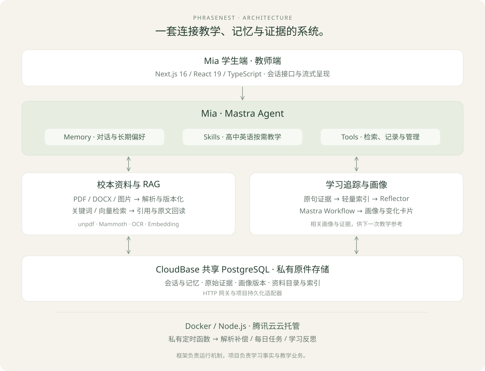

# 从功能到技术

拾语把材料、对话、证据与教学动作分开管理，再在需要时连接起来。

## 前台快循环：先教学，同时留下线索

浏览器通过流式接口收取正文、工具进度、用量和学习变化。学生问题先保存，生成中断也保留部分正文；重试使用轮次标识和租约，减少重复写入。

Mia 根据当前任务使用原生 Skill，选择检索、读原文、查个人记录、维护资料或记录证据。身份由服务端绑定，模型不需要传入学生身份。

证据保留来源、原句、语境、原因和单独的修改参考。原错不被“修好后的句子”覆盖；提问可以成为学习关注点，但不自动当作错误。

## 后台慢循环：从线索到可解释的画像

Reflector 先读轻量索引与既有画像，必要时回读相关轮次、前后文和版本化资料。Mastra Workflow 组织分析与提交，业务任务、租约和失败状态负责持久恢复。

画像将有效证据、修订与反思结果组合为读模型。每个主题可回到来源；新作答和教师复核可以修正判断。知识网络是关系与主题的产品视图，不要求独立图数据库。

## 对话记忆、学习事实与资料分层

- **原生记忆**：消息、Working Memory、Observational Memory 与历史回查，保持多轮连续性。
- **业务证据**：原文、批改、索引、判断修订与新作答，保存可核对的事实。
- **资料库**：目录、版本、分块、检索索引和原件，为需要时的查询提供依据。
- **画像**：对证据的教学解读，不覆盖原始事实。

共享 PostgreSQL 通过 HTTP 网关访问。项目实现了 Mastra 持久化适配器，复用原生生命周期算法并以 CAS 提交；它**不是**官方 `@mastra/pg` TCP 驱动的共享库配置。

## 文档不是“上传成功”就完成了

原件先保存，解析进入任务状态，再提取正文、分块与索引。PDF 使用 unpdf，扫描页可接 OCR，DOCX 使用 Mammoth。页面提供进度、恢复状态与预览。

Agent 决定检索 query 和模式。结果带来源、版本与读取位置；核对原文后再引用。长行续读和范围覆盖显式呈现，不把片段说成全文。

## 上下文与成本工程

稳定公共教学前缀，动态追加问题、相关画像和检索内容；完整作文、局部追问和旧错练习使用不同范围。相同原文可在一次请求中复用，长期存储不会因此删除。

按调用步骤记录用量，缓存是输入的一部分；Observer / Reflector 辅助调用另列。缺失用量保持未知，不用字符数冒充 token 或实际账单。

047 可切换新旧提示词与 Skill；两版共用模型、数据库和长期记忆，不是完全隔离的教学实验。

## 部署与教师协作

Docker 镜像只承载代码与依赖。持久数据及私有原件存储在容器之外，普通发布不恢复本地快照。

教师端支持班级、CSV批量账号、一次性激活与统一证据视图。AI判断和教师复核分开保存，班级关系决定可见范围。当前为试点规模，尚未通过大规模多校并发验证。

私有定时函数按北京时间检查每日任务，到期触发平台内生成。站内结果不等于系统通知，不宣称支持手机锁屏推送。

[返回主页](../README.md) · [已知问题](known-issues.md)
